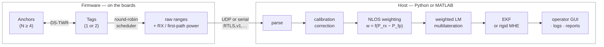
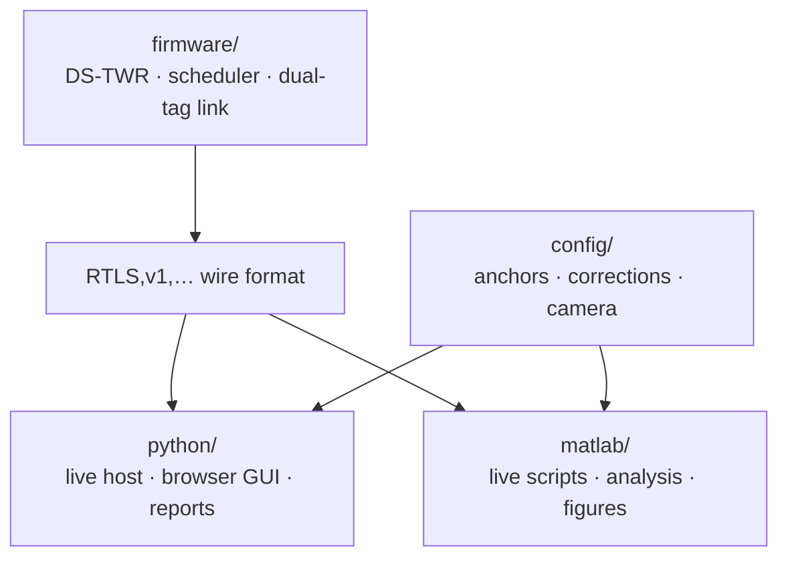

# DUNE — Dual-tag UWB Navigation Engine

**An open, complete indoor localization stack for ground robots, built on commodity
DW1000 radios.** Firmware, ranging protocol, dual-tag synchronization, two-tier
calibration, camera-free anchor survey, robust solving, and a rigid-body moving-horizon
estimator — the whole path from a bare ESP32 board to a metric pose.

Most open UWB projects stop at ranging and leave calibration, anchor survey, scheduling,
solving, filtering and validation to you. Those are the parts that actually decide whether
a deployment works. DUNE ships all of them.

> ### Core design principle
> **The tag streams raw ranges. All position solving happens on the host.**
>
> The firmware never computes a position. Anchor geometry, calibration corrections and
> the choice of estimator are host-side configuration, not firmware constants — so adding
> an anchor, moving one, or swapping the estimator needs no reflash. Every recorded
> session replays offline through the *identical* solve path used live, which is how the
> estimator comparison below is obtained.

---

## Results

Five anchors around a ~5×3 m arena, ground truth from an overhead Kinect v2 tracking an
AprilTag, registered to the anchor frame at 13.5 mm RMSE — the error floor of every number
here.

| | RMSE | Median | 95th pct. |
|---|---|---|---|
| Antenna-delay calibration only | 199 mm | 144 mm | 386 mm |
| **+ received-power correction** | **94 mm** | **69 mm** | 160 mm |
| Oracle (best possible static map) | 72 mm | 31 mm | — |
| Temporal filtering, at rest | **60–65 mm** | | |

Dual-tag estimator comparison, identical logged sweeps and identical truth:

| | Per-tag EKF | **Rigid MHE (ours)** |
|---|---|---|
| Position RMSE | 171 mm | **126 mm** |
| Estimated path length | 1.9× truth | **1.3× truth** |
| Inter-tag baseline | unconstrained | **exact by construction** |
| Solve time / update | <1 ms | 3 ms median (30 ms p95) |

The path-length column matters more than the accuracy one. A ratio of 1.9 means the
filtered track is nearly twice as long as the route actually driven — the estimate wanders
rather than lags. The rigid estimator *cannot* wander that way, because doing so would
require the two antennas to move relative to one another, and the state has no way to
express that.

Across 28 driven runs the median error is 227 mm (45–858 mm); restricted to the 18 runs
where the platform actually moved, 184 mm (66–383 mm).

---

## How it fits together



Calibration and anchor survey do not process measurements — they parameterise the stages
that do.

**Two host pipelines, one firmware.** Python and MATLAB implement the same solve path over
the same wire format and read the same `config/`. Use either; they interoperate on the same
logs. See [docs/choosing_a_pipeline.md](docs/choosing_a_pipeline.md).



---

## What's here

| | |
|---|---|
| [`firmware/`](firmware/) | Single-source Arduino library + five board roles. DS-TWR engine, addressed framing, round-robin scheduler with per-anchor backoff, wired dual-tag link, charge mode. |
| [`python/`](python/) | Live host, browser operator GUI, offline replay and reports, 253 tests. |
| [`matlab/`](matlab/) | The second host pipeline: live scripts, calibration tooling, analysis. |
| [`config/`](config/) | Anchor geometry, per-anchor corrections, camera calibration. **Read by both pipelines.** |
| [`examples/`](examples/) | Small runnable demos — start here. |
| [`hardware/`](hardware/) | CAD, datasheets, board photos. |
| [`docs/`](docs/) | Everything below. |
| [`data/`](data/) | Datasets — distributed separately, see [docs/datasets.md](docs/datasets.md). |

---

## Quickstart

```bash
git clone https://github.com/AdershM-2/DUNE
cd DUNE
pip install -e "python/[all]"

# No hardware yet? Solve a synthetic five-anchor geometry:
python examples/five_anchor.py

# With hardware, once anchors are flashed and config/anchors.json is set:
python python/run_localization.py            # UDP :4100, opens the GUI
python python/run_localization.py --serial /dev/ttyUSB0
```

MATLAB:

```matlab
cd matlab
dune_setup        % reports what it found
live_rover        % dual-tag rigid MHE
```

Going from bare boards to a first fix: **[docs/getting_started.md](docs/getting_started.md)**.

## Documentation

**Start:** [Getting started](docs/getting_started.md) · [Architecture](docs/architecture.md) ·
[Choosing a pipeline](docs/choosing_a_pipeline.md)

**Deploy:** [Hardware & BOM](docs/hardware.md) · [Calibration](docs/calibration.md) ·
[Anchor self-survey](docs/anchor_survey.md) · [Troubleshooting](docs/troubleshooting.md)

**Reference:** [Wire protocol](docs/protocol.md) · [Estimators & NLOS](docs/estimators.md) ·
[Dual-tag link](docs/dual_tag_link.md) · [Python](docs/python_pipeline.md) ·
[MATLAB](docs/matlab_pipeline.md) · [Ground truth rig](docs/vision_ground_truth.md) ·
[Compatibility](docs/compatibility.md) · [Datasets](docs/datasets.md)

---

## Hardware

Built on 4–7× Makerfabs "ESP32 UWB Pro with Display" (Decawave DW1000). Full bill of
materials, wiring and board roles in [docs/hardware.md](docs/hardware.md).

| | |
|---|---|
| Transceiver | Decawave DW1000, channel 5, 110 kbit/s, 64 MHz PRF, 2048-symbol preamble |
| Timestamp quantum | 15.65 ps (4.69 mm) |
| Anchors / tags | 5 / 2 in the reported deployment; any N ≥ 4 anchors |
| Sweep rate | 3.9–4.25 Hz per tag |
| Tag baseline | 0.550 m |

Because the ranging, scheduling and framing code sits *above* the device driver, porting to
a newer transceiver — a DW3000, say — is confined to the driver layer.

## Paper implementation status

| Component | Status |
|---|---|
| Firmware: DS-TWR, scheduler, framing, backoff | ✅ |
| Dual-tag wired synchronization (TagLink) | ✅ |
| Tier-1 antenna-delay calibration | ✅ |
| Tier-2 first-path-power correction | ✅ |
| Camera-free anchor self-survey | ✅ |
| Same-frame NLOS weighting | ✅ |
| Weighted multilateration + guards | ✅ |
| Rigid-body moving-horizon estimator | ✅ |
| Python pipeline | ✅ |
| MATLAB pipeline | ✅ |
| Operator GUI | ✅ |
| Offline replay and reports | ✅ |
| Documentation | ✅ |
| CAD, datasheets, board photos | ⬜ pending |
| Datasets (rover runs, static campaign, CIR, survey) | ⬜ pending curation |

## Citing

If DUNE is useful in your work, please cite the paper — see [CITATION.cff](CITATION.cff).

## License

MIT, except the vendored Decawave/thotro DW1000 driver under
`firmware/libraries/UwbRtls/src/dw1000/`, which is Apache-2.0 and retains its upstream
headers. See [LICENSE](LICENSE).

Contributions welcome — see [CONTRIBUTING.md](CONTRIBUTING.md).
