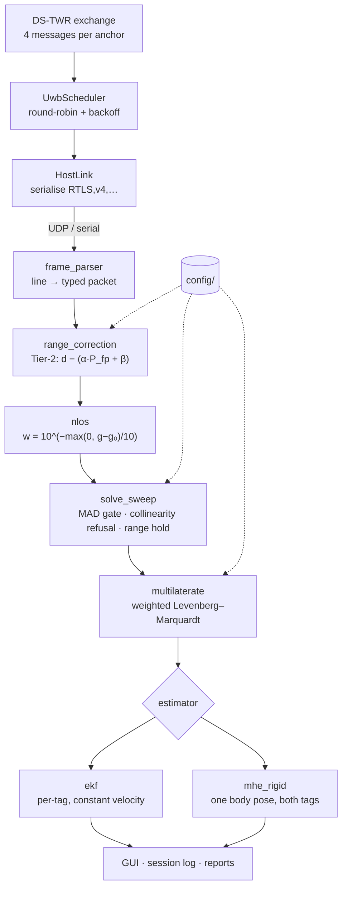

# Architecture

One page. Read this before changing anything; it says what owns what and where a given
change belongs.

## The rule everything follows

> **The tag streams raw ranges. All position solving happens on the host.**

The firmware never computes a position, never applies a calibration correction, and never
decides which anchors to trust. It measures, and it reports what it measured along with the
radio diagnostics needed to judge the measurement.

Three consequences, and they are the reason for the rule:

1. **Anchor geometry is host configuration.** Adding an anchor, moving one, or re-surveying
   the constellation is a `config/anchors.json` edit — no reflash.
2. **Every session replays.** A recorded log runs back through the *identical* solve path
   used live. Estimator comparisons are therefore honest: same inputs, same code, only the
   estimator swapped.
3. **Porting is confined to the driver.** Ranging, scheduling and framing sit above the
   DW1000 register layer, so a DW3000 port touches `firmware/libraries/UwbRtls/src/dw1000/`
   and nothing above it.

## Data flow



Calibration and anchor survey are **not** in this path. They produce the files in `config/`
that parameterise it.

## Directory responsibilities

| Directory | Owns | Does **not** |
|---|---|---|
| `firmware/libraries/UwbRtls/src/` | ranging, scheduling, framing, host serialisation, dual-tag link, charge mode | compute position, apply calibration |
| `firmware/libraries/UwbRtls/src/dw1000/` | DW1000 register access, SPI, interrupt servicing | know anything about DUNE |
| `firmware/sketches/` | per-board role and per-board constants (`ANCHOR_ID`, `TAG_ID`, `ANTENNA_DELAY`) | hold algorithms — those are in the library |
| `python/dune/` | **the library**: parse, correct, weight, solve, estimate | know about the GUI, jobs, or transports |
| `python/host/` | the running application: transports, event bus, job registry, path policy | contain algorithms |
| `python/reports/` | offline replay and scoring, `.mat` I/O | run live |
| `python/rover/` | rover control and synchronized capture | localize |
| `python/tools/` | operator command-line tools, one task each | be imported by the library |
| `python/vision/` | overhead-camera ground truth | participate in localization |
| `matlab/+dune/` | the same library, in MATLAB | diverge from the Python semantics |
| `matlab/scripts/` | live and offline entry points | hold reusable logic |
| `config/` | the deployment's parameters, read by **both** pipelines | contain code |

## The layering rule inside `python/`

```
tools/  run_localization.py        entry points
   │
host/   app · ingest · jobs · bus  application
   │
reports/  rover · replay           offline analysis
   │
dune/   the library ──────────────► depends on nothing above it
```

`dune/` must never import from `host/`. That is why locations live in `dune/paths.py`
(pure constants) and only *policy* — which directories the browser may reach, and the
containment check on untrusted paths — lives in `host/paths.py`. If you find yourself
wanting `from host...` inside `dune/`, the thing you want belongs in `dune/`.

## Where to make a change

| You want to… | Change | Reflash? |
|---|---|---|
| Move or add an anchor | `config/anchors.json` | no |
| Re-survey the constellation | run the self-survey, rewrite `anchors.json` | no |
| Change the estimator or its tuning | `python/dune/fusion_config.py`, or the GUI sliders | no |
| Change NLOS weighting policy | `python/dune/nlos.py` + `matlab/+dune/gapWeights.m` | no |
| Add a per-anchor correction | `config/range_correction.json` | no |
| Change the ranging exchange or scheduler | `firmware/libraries/UwbRtls/src/` | **yes, all boards** |
| Change an antenna delay | that board's sketch | that board |
| Add a wire-format field | `HostLink.h` + both parsers, together | **yes, tags** |
| Port to another transceiver | `firmware/libraries/UwbRtls/src/dw1000/` | yes |

## Two pipelines, one meaning

Python and MATLAB are independent implementations of the same algorithms over the same wire
format and the same `config/`. They are held together by tests, not by convention:
`python/tests/test_equivalence.py` and `test_pipeline_equivalence.py` replay recorded
sessions through the Python path and compare against what MATLAB wrote for the same
sweeps. `test_mhe.py` compares the two moving-horizon implementations at *metric* level —
not per-sample, because MATLAB uses the CasADi MEX build and Python the pip wheel, and two
IPOPT instances need not take the same route to the same optimum.

Which to use, and why both exist: [choosing_a_pipeline.md](choosing_a_pipeline.md).

## Testing philosophy

`python/tests/` holds 253 tests. Two conventions worth knowing before you add to them:

- **Data-dependent tests skip, they do not fail.** A fresh clone ships no datasets, so
  44 tests skip. That is expected. If you have the dataset drop unpacked in `data/`, they
  run.
- **A test must not write into the checkout.** `tests/conftest.py` redirects `RESULTS_DIR`
  at a scratch directory that is deleted per test. The reason is in that file, and it is
  worth reading: debris from one run silently changed the *outcome* of the next.
